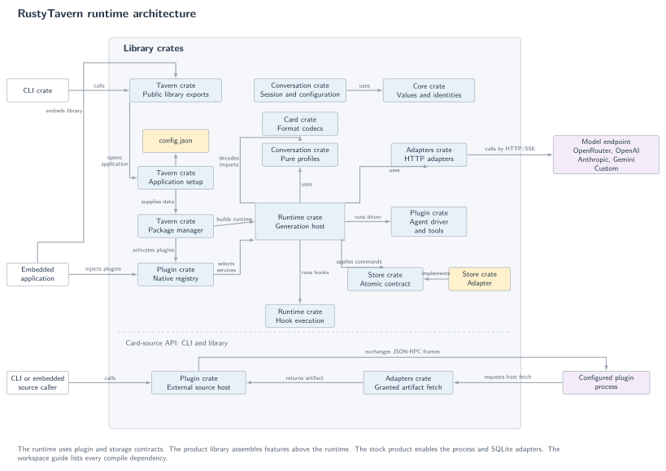
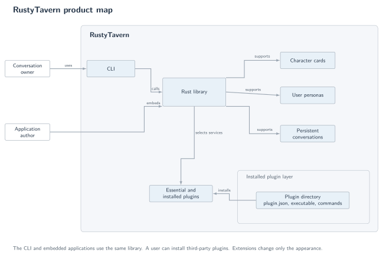
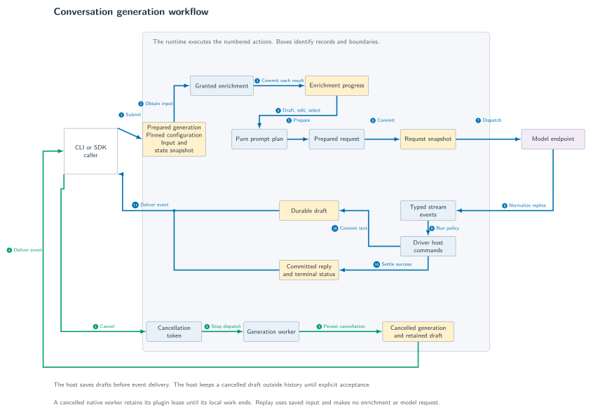
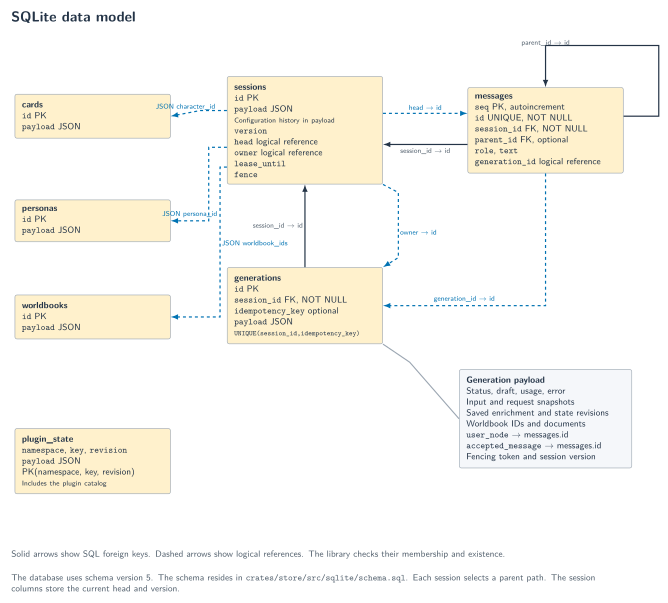

# Architecture

## Current implementation

RustyTavern uses a virtual workspace with five crates. Each crate owns one layer and its README.
Modules separate related implementation areas within each crate. The CLI supplies the interactive terminal and script commands.
The product library assembles the runtime, the essential plugins, installed plugins, and extensions. The runtime uses the session, prompt, and storage interfaces.
A plugin changes agent behavior or adds content to the agent context. An extension changes only the application appearance.



| Directory | Package | Responsibility |
| --- | --- | --- |
| [`core`](../crates/core/README.md) | `rustytavern-core` | Shared errors, identities, personas, messages, artifact records, character cards, worldbooks, and format diagnostics. |
| [`session`](../crates/session/README.md) | `rustytavern-session` | Session records, provider settings, native exports, pure prompt compilation, and the SQLite store. |
| [`runtime`](../crates/runtime/README.md) | `rustytavern-runtime` | Rig provider and source adapters, plugin contracts, the external process host, prompt phases, and the Rig agent runtime. |
| [`tavern`](../crates/tavern/README.md) | `rustytavern` | Product assembly, the essential plugins, installed plugins, extensions, configuration, and public library exports. |
| [`cli`](../crates/cli/README.md) | `rustytavern-cli` | The interactive terminal and script interface. |

The dependency graph is one chain: core, session, runtime, product, and CLI. The runtime has no product library dependency.
The [workspace guide](architecture.md#workspace-boundaries) records dependency direction and feature choices.

### Runtime ordering

The [prompt phases](developer.md#phase-order) define preparation through request persistence. The host performs network I/O outside database transactions.
The host persists each draft delta before event delivery. The host commits the assistant node and terminal status atomically.
Each session permits one writer through a lease, fencing token, and expected version. Recovery interrupts expired work without restarting model requests.
Blocking workers run storage and compilation while the runtime renews the lease. A cancelled worker retains its composition until its local work ends.
A bounded observer queue cannot block durable completion. The caller reads durable results after a `missed_events` gap.

### Runtime replacement

The [registry contract](developer.md#design) defines dependencies, rollback, ownership, and leases. The runtime selects decoder, driver, profile, provider, and store services from the frozen registry.
A generation records that composition in its input snapshot. Each session pins its composition through an immutable [configuration revision](user-guide.md#session-configuration-revisions).
The user must adopt a changed composition explicitly.

### State and context

The store keeps the full message tree and one selected branch head. Regeneration adds an assistant sibling.
An edit adds a node without changing existing descendants. The compiler selects context without deleting history.
[Draft acceptance](user-guide.md#explicit-partial-reply-acceptance) adds a retained partial reply through an explicit message link.
[Native exports](user-guide.md#native-records-and-exports) retain the tree, revision archives, and opaque plugin state.
The counter estimates tokens from UTF-8 bytes, including the serialized request body. The budget reserves output capacity and a protocol margin.
The final budget pass removes history, examples, lore, and optional contributions in that order. The plan records each omission.
Required context overflow stops dispatch.
[Inspection and replay](developer.md#offline-inspection-and-replay) expose pure compilation.

### Plugins and extensions

The [plugins module](../crates/tavern/README.md) holds the essential plugins. The standard agent activates them by default.
The [plugin manager](developer.md#installed-plugins) installs third-party plugins from local directories and owns their commands and enabled state. The runtime registry enforces plugin grants and lifecycle rules.
The plugin catalog uses versioned `plugin_state` records.
The [extension interface](developer.md#extensions) owns application appearance. An extension has no access to the plugin registry.

### Error handling

The shared error uses thiserror. The error retains its underlying cause in memory.
The public record contains a stable code and a safe message. Serialization omits the internal cause.
The CLI maps the same code to its exit status.

## Target runtime

The [product target](product.md#required-target) includes agent, media, audio, and discovery features. The current figures show implemented code only.
The essential [agent driver](../crates/tavern/README.md#agent-and-tools) runs a bounded tool loop. It does not implement that full target yet. The core host must own persistence, permission checks, cancellation, and resource limits.
The core host must bound request counts, tool steps, deadlines, event counts, and stored artifacts. Plugins must implement behavior and adapters through declared services.
Third-party plugins must declare their services, grants, and commands. A plugin must not bypass durable host transitions through a replacement driver.
The host must save operation inputs and results before it exposes durable events. New service families must preserve configuration adoption and replay boundaries.

## Workspace boundaries

### Dependency direction

The session crate owns pure records, prompt compilation, and storage. The runtime depends on the session crate.
The product library depends on the runtime. The runtime has no product library dependency.
The CLI depends on the assembled product library. The library has no terminal dependency.
The model and source adapters keep separate modules and network policies. The product library keeps plugin installation and extensions above the runtime plugin contracts.

| Package | Direct workspace dependencies |
| --- | --- |
| `rustytavern-core` | The package has no workspace dependency. |
| `rustytavern-session` | `rustytavern-core` |
| `rustytavern-runtime` | `rustytavern-core`, `rustytavern-session` |
| `rustytavern` | `rustytavern-core`, `rustytavern-session`, `rustytavern-runtime` |
| `rustytavern-cli` | `rustytavern` |

### Public library paths

The assembled `rustytavern` library keeps its module paths. The `app` module installs third-party plugins and owns application setup. The `extension` module owns application extensions. The `plugins` module holds the essential plugins.
The `config` module owns product configuration. The `card`, `session`, `prompt`, `plugin`, `external`, `provider`, `source`, `runtime`, and `store` paths re-export the lower crates.
The data formats and database schema do not change.

## Dependency reuse

The project reuses libraries for general infrastructure. The project keeps its runtime policy separate from those libraries.

| Function | Existing dependency | Project responsibility |
| --- | --- | --- |
| JSON and records | `serde`, `serde_json` | The importer enforces format policy and preserves unknown values. |
| HTTP and TLS | `reqwest` | The host enforces endpoint grants, address checks, limits, and cancellation. |
| Model protocols and agent loop | `rig-core`, `rig-agent` | The runtime owns tool composition, durable drafts, usage records, leases, and error codes. |
| SQLite | `rusqlite` | The store owns transactions, fencing, and the SQL schema. |
| Errors | `thiserror` | The public error excludes private causes and credentials. |
| Async work and cancellation | `tokio`, `tokio-util` | The runtime owns leases, cleanup, and durable completion. |
| CLI | `clap` | The CLI maps commands to library operations. |
| Terminal rendering | `ratatui`, `crossterm`, `syntect` | The CLI owns event handling, restoration, the inline area, scrollback history, and code colors. |
| Text editing | `ratatui-textarea` | The CLI owns form validation, slash routing, and input bounds. |
| Markdown | `pulldown-cmark`, `unicode-width` | The CLI converts messages into styled and wrapped transcript lines. |
| Versions | `semver` | The plugin registry checks declared dependencies. |
| Binary metadata | `base64`, `crc32fast` | The card importer applies envelope precedence and byte limits. |
| CHARX archives | `zip` | The card importer checks metadata, paths, CRC values, and expansion limits. |

### Card-format candidate

The project has not added `chara_card` version `0.4.1`. That version requires a newer ZIP dependency than the Rust 1.85 baseline supports.
A replacement decoder must preserve original bytes, unknown fields, envelope rules, bounds, and diagnostics.

### ZIP adapter

The card crate uses `zip` version `7.3` with Deflate on Rust 1.85. The adapter reads bounded entries in memory and checks counts before index allocation.
The adapter rejects special files and never extracts files to disk. The project must reassess extraction advisories before it adds filesystem extraction.

### Further candidates

An event-stream replacement must pass fragmentation, limits, failures, and cancellation checks. A token counter must identify its model and tokenizer version.
The product must retain estimated-count labels for other models.

## Architecture figures

The figures show the current implementation. The product map includes the installed plugin layer.

### Build

The renderer requires `latexmk` and `pdftocairo`.

```sh
make -C docs/assets
```

The sources remain editable TikZ files. The build creates PDF and SVG files.
The reviewed PNG files provide previews.

### Product map



[TikZ source](assets/product-map.tex) · [PDF](assets/product-map.pdf) · [SVG](assets/product-map.svg) · [PNG](assets/product-map.png)

### Runtime architecture


[TikZ source](assets/runtime-architecture.tex) · [PDF](assets/runtime-architecture.pdf) · [SVG](assets/runtime-architecture.svg) · [PNG](assets/runtime-architecture.png)

### Generation workflow



[TikZ source](assets/generation-workflow.tex) · [PDF](assets/generation-workflow.pdf) · [SVG](assets/generation-workflow.svg) · [PNG](assets/generation-workflow.png)

### DB model



[TikZ source](assets/database-model.tex) · [PDF](assets/database-model.pdf) · [SVG](assets/database-model.svg) · [PNG](assets/database-model.png)

The DB model uses solid arrows for SQL foreign keys. The DB model uses dashed arrows for logical references.
The library checks logical references before it changes a branch or binding. The diagram does not claim that SQLite enforces every logical reference.
